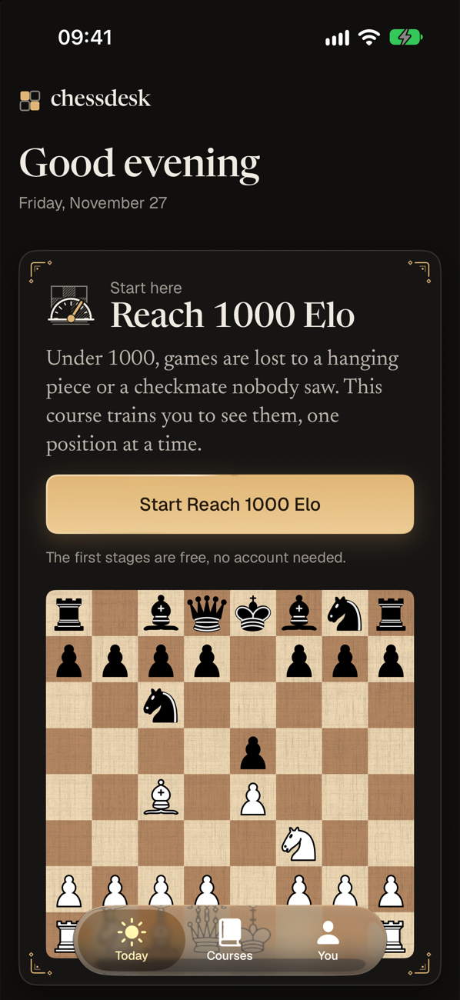
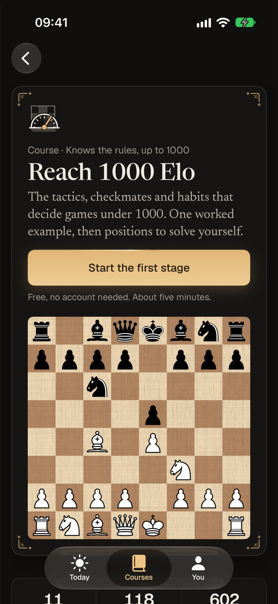
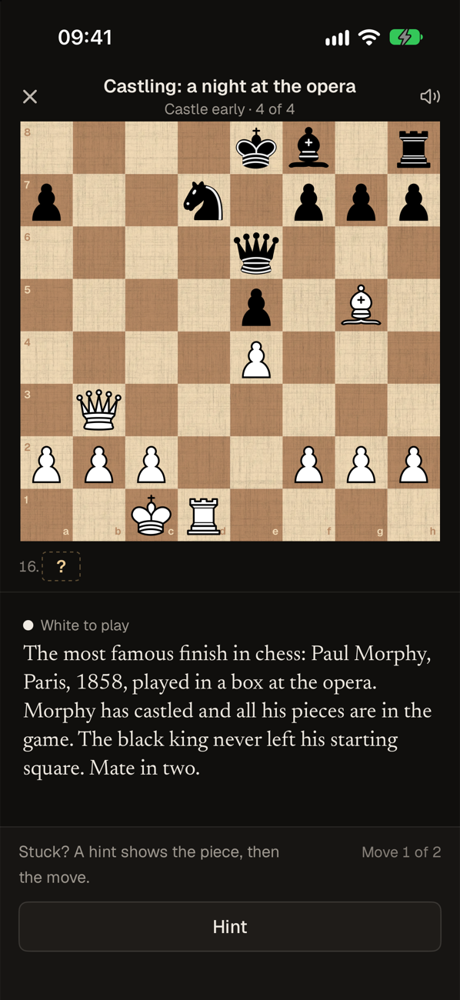
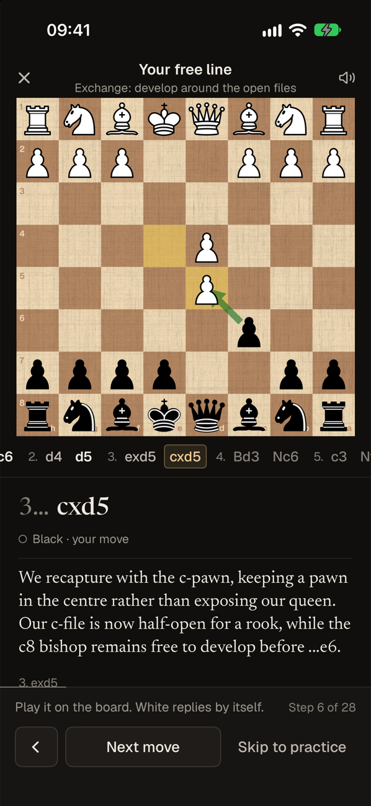

<div align="center">


# ChessDesk for iOS

**Learn chess openings and the habits that win games under 1000 Elo, on iPhone and iPad.**

The native app of [chessdesk.app](https://chessdesk.app), written in SwiftUI,
with Stockfish 19 running on the device.

[](https://github.com/Drafted-by/chessdesk-ios/actions/workflows/ci.yml)


[](LICENSE)

</div>

<p align="center">
  
  
  
  
</p>

> ChessDesk for iOS is in development and not on the App Store yet. Everything below runs
> today in the simulator, on sample data, without an account.

## What it does

- **Reach 1000 Elo.** A course for players who know the rules: the tactics, checkmates and
  habits that decide games under 1000. Each stage is one worked example, then positions to
  solve yourself. The first stages are free, no account needed.
- **Stockfish on the device.** When you solve a position with a move that is not the
  course's, Stockfish 19 checks it and accepts it when it is as good (within 35 centipawns,
  or a mate on schedule). Nothing leaves the phone.
- **Opening courses.** A catalogue of repertoires; each course has its chapters and lines.
- **The opening trainer.** Learn a line move by move, with notes, arrows and narration when
  the course is voiced, then play it from memory with hints.
- **Guest first.** No account is needed to start. What a guest learns stays on the device
  and moves to their account when they sign in.

Not built yet: buying Premium in the app, Sign in with Apple and Google, and reviewing your
own games with the engine.

## How it is built

It is a native app, not a web view: the screens, the board and the trainer are written in
Swift. Everything a player owns (account, courses, progress, Premium) lives on the ChessDesk
backend, behind the app API (`/api/v1`), so the server decides what a player may see and
the app shows it.

| Part | What it is |
|---|---|
| `ChessDesk/` | The SwiftUI app: Today, Courses, the trainer, the account, the board |
| `Packages/ChessCore` | Chess rules in Swift, no dependency: legal moves, FEN, SAN, checked by perft |
| `Packages/StockfishEngine` | Stockfish 19 as a library: the official source unmodified (without `main.cpp`), an in-process UCI bridge and a Swift client |
| `Fixtures/api-v1` | Sample data: answers of the API as a guest sees them, used by Debug builds, previews and tests |
| `contracts/openapi-v1.json` | The contract of the app API; a test checks that the app's models decode it |

A few rules hold the code together:

- **Backend first.** A rule that decides what a player may do or see (paywall, limits,
  scheduling) is the server's. The app does not recompute it.
- **Screens depend on the `ChessDeskAPI` protocol**, never on URLSession, so every screen
  runs on sample data.
- **The API is additive.** The app ignores fields it does not know.
- **One design system.** Colours, type and spacing come from `UI/Tokens.swift` and
  `UI/Typography.swift`, which mirror the site: warm graphite, paper ink, one brass accent,
  Newsreader for titles and prose, Geist for the rest. A view never hardcodes them.
- **A tab appears when it works end to end.** No "coming soon" tabs.

## Run it

You need a Mac with Xcode and an iOS 17 or later simulator.

```bash
brew install xcodegen
scripts/fetch-nnue.sh          # once: the Stockfish network (98 MB, not committed)
xcodegen generate              # the project file is not committed
open ChessDesk.xcodeproj
```

Or from the terminal, on a simulator named "ChessDesk iPhone" or "ChessDesk iPad":

```bash
xcrun simctl create "ChessDesk iPhone" "iPhone 17"     # once
scripts/sim.sh iphone          # build, install and launch
```

A Debug build starts on **sample data**, so it works offline and without an account. The
backend can be changed in the app (tab You, section Developer) or at launch:

| Launch argument | Backend |
|---|---|
| none (Debug) | Sample data from `Fixtures/api-v1` |
| `-CDBackend local` | `http://localhost:3000` |
| `-CDBackend production` | `https://chessdesk.app` (what a Release build uses) |

Debug launch arguments also open a screen directly:

```bash
scripts/sim.sh iphone -CDRoute path
scripts/sim.sh iphone -CDRoute stage/castle-early -CDExercise 4
scripts/sim.sh iphone -CDRoute premium
scripts/sim.sh iphone -CDRoute account/signin
scripts/sim.sh iphone -CDRoute course/practical-caro-kann
scripts/sim.sh iphone -CDRoute trainer/practical-caro-kann -CDTrainerSteps 5
scripts/sim.sh iphone -CDRoute trainer/practical-caro-kann -CDTrainerMemory YES
```

## Tests

```bash
swift test --package-path Packages/ChessCore         # chess rules, no simulator needed
swift test --package-path Packages/StockfishEngine   # the engine, on the Mac
xcodebuild test -project ChessDesk.xcodeproj -scheme ChessDesk \
  -destination 'platform=iOS Simulator,name=ChessDesk iPhone'
```

What they hold:

- **Chess rules**: perft node counts on six reference positions (castling, en passant,
  promotion, pins), FEN, SAN.
- **Server lines replay**: every move of the sample sessions is legal for ChessCore, and the
  app and the server agree on the position and on the notation.
- **Contract**: an example built from the required fields of each schema decodes into the
  app's models, and every route the app calls is in the contract.
- **Trainer**: the guided pass, a wrong move held and taken back, the memory pass and its
  grades, lessons, positions to solve, and when the engine is asked about another move.
- **Engine**: Stockfish finds a mate and judges material, on the Mac and inside the app in
  the simulator.
- **Narration**: the app computes the same clip key as the site for every note.

## Licence

The source code of ChessDesk for iOS is free software under the
**GNU General Public License, version 3** ([LICENSE](LICENSE)).

It embeds [Stockfish](https://stockfishchess.org) 19, also GPL-3.0. Its source is in
`Packages/StockfishEngine/Sources/CStockfish/stockfish`, with its `Copying.txt` and
`AUTHORS`. The engine is linked into the app and driven over UCI text through `bridge.cpp`.

**Not covered by the GPL**, and not free to reuse:

- The ChessDesk name, logo and app icon.
- The course content in `Fixtures/api-v1` (lines, explanations, exercises): © Drafted-by,
  all rights reserved. It is here so the app builds and its tests run.
- The board texture, an asset of Drafted-by.
- The two board sounds (move, capture). They come from Lichess and are licensed to
  Drafted-by for ChessDesk only, so they are **not in this repository**. Without them the
  app builds and runs silently; official builds add them with `scripts/fetch-sounds.sh`.
- The ChessDesk backend, which is not part of this repository.

Third-party assets keep their own licences:

- Chess pieces: the CBurnett set by Colin M.L. Burnett, BSD licence.
- Typefaces: Newsreader (Production Type) and Geist (Vercel), SIL Open Font License 1.1;
  the licence texts are in `ChessDesk/Resources/Fonts`.

## Contributing

Bug reports and ideas are welcome in the [issues](https://github.com/Drafted-by/chessdesk-ios/issues).
For anything larger than a fix, open an issue first so we can agree on the direction.
